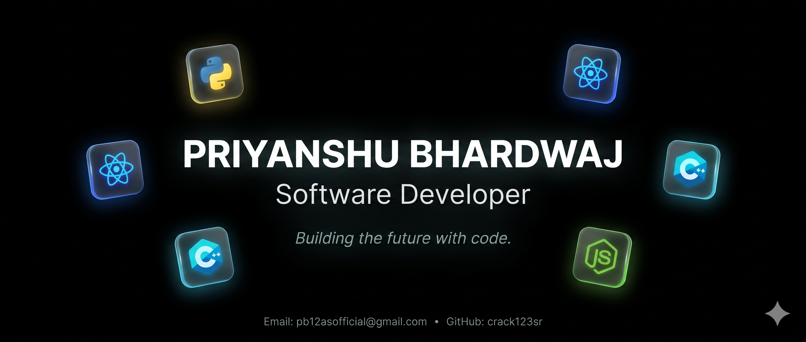

  

<h1 align="center">Hi, I'm Priyanshu Bhardwaj 👋</h1>
<h3 align="center">Software Developer · Full-Stack Engineer · AI/ML Enthusiast</h3>

  <em>Building reliable software, intelligent applications, and systems that solve real problems.</em>

  
  
  

I'm a B.Tech student at **National Institute of Technology, Jamshedpur**, pursuing **Computational Engineering**. I build full-stack applications and AI-powered systems, with interests spanning backend engineering, microservices, machine learning, and retrieval-augmented generation (RAG).

- 🎓 **Education:** B.Tech in Computational Engineering, NIT Jamshedpur (2023–2027)
- 🔬 **Research Intern:** SSPL Lab, DRDO — developed an ML classification system for crystal-growth state detection.
- 💻 **Core interests:** Full-stack development, backend systems, microservices, AI/ML, and practical LLM applications.
- 🧠 **Problem solving:** Selected for AlgoUniversity's Graph & DP Camp from a pool of 60,000+ students.
- 🏆 **Achievement:** Top 5% performer in Flipkart GRIDLOCK 2026 (Top 1,500 among 34,600+ participants).
- 🌱 **Currently exploring:** Scalable system design, cloud technologies, and production-ready AI applications.

---

## 🧰 Tech Stack

### Languages

  
  
  
  
  
  
  
  

### Frontend

  
  
  

### Backend, APIs & Architecture

  
  
  
  
  
  

### Databases, Cloud & Developer Tools

  
  
  
  
  
  
  
  
  

### AI / ML & LLM Applications

  
  
  
  
  
  
  

### CS Fundamentals
`Data Structures & Algorithms` · `Object-Oriented Programming` · `Operating Systems` · `DBMS`

---

## 🚀 Featured Projects

### 💳 FinDrive — AI-Powered Financial SaaS Platform
**Tech:** MERN Stack, TypeScript, Cloudinary, Cron Jobs, Stripe API, Google Gemini API

- Built a financial management platform with transaction tracking and recurring-payment automation.
- Created dynamic income and expense analytics using MongoDB aggregation pipelines.
- Integrated AI-powered receipt scanning, Stripe payment processing, subscription management, and Cloudinary storage.

### 🛒 Scalable Microservices E-commerce WebApp
**Tech:** TypeScript, MERN, Microservices, Docker, Apache Kafka, Stripe API, Clerk, Resend

- Developed an e-commerce platform with product browsing, cart management, dynamic inventory handling, and secure checkout.
- Used Kafka for event-driven communication between microservices.
- Integrated Clerk authentication, Stripe payments, automated transactional emails, Zustand state management, and Docker containerization.

### 🤖 Multi-Domain AI Support Triage Agent — HackerRank Orchestrate
**Tech:** Python, Sentence Transformers, FAISS, Gemini API, Pandas, NumPy, Pydantic, Prompt Engineering

- Built a RAG-based support-ticket triage system that classifies queries and searches more than 900 support documents using FAISS.
- Implemented a pipeline for semantic retrieval, risk assessment, grounded response generation, and escalation of sensitive cases.
- Designed the system to support HackerRank, Claude, and Visa domains.

---

## 🔬 Professional Experience

### Research Intern — SSPL Lab, DRDO
**May 2025 – June 2025**

- Architected an end-to-end machine-learning classification system for crystal-growth state detection.
- Trained scikit-learn models including Random Forest and SVM, achieving **92% accuracy** and a **94% defect-detection rate**.
- Deployed a REST API integrated with the lab monitoring system, helping enable a reported **40–50% reduction in failed experiments**.

---

## 🏅 Certifications & Achievements

- **Flipkart GRIDLOCK 2026:** Top 5% performer — Top 1,500 among 34,600+ participants in a national AI/ML hackathon.
- **AlgoUniversity Graph & DP Camp:** Selected from 60,000+ students for mentorship under a Codeforces Master; studied graph algorithms, dynamic programming, matrix exponentiation, and SQRT decomposition.
- **Prompt Engineering Certification:** Prompt design for LLM-assisted problem-solving and workflow automation.
- **Generative AI Certification:** LLMs, generative AI fundamentals, and practical AI applications.

---

## 🌐 Socials

 

## 📊 GitHub Stats

 
 

### ✍️ Random Dev Quote

  

